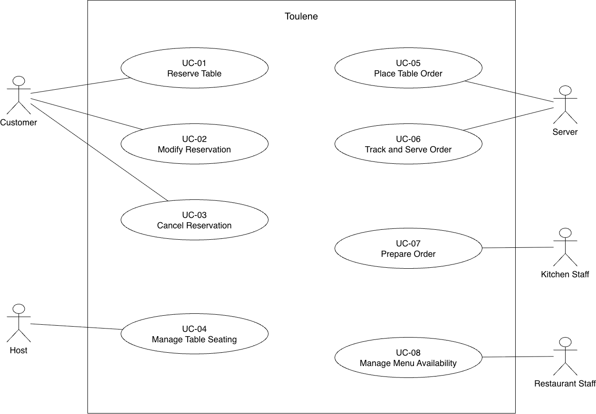

# P2 Section 3 updates

Sections 3.1 and 3.4 updates. The requirement wording, IDs, and acceptance criteria are unchanged from P1.

## 3.1 Functional requirements

| ID | Requirement | Priority | Source | Acceptance criterion |
| --- | --- | --- | --- | --- |
| FR-01 | The system shall display available reservation time slots for a customer’s selected date and party size based on table capacity and existing reservations. | MUST | Customer need [R2], [R3] | Given a table for four is available at 6:00 PM, a search for four guests includes that slot; a search for five excludes it unless another suitable table is available. |
| FR-02 | The system shall create a reservation with a unique confirmation number when a customer submits valid contact details, party size, and an available time slot. | MUST | Customer need [R2], [R3] | Submitting valid details for an available slot creates one reservation and displays its unique confirmation number. |
| FR-03 | The system shall prevent reservations that allocate the same table to overlapping reservation periods. | MUST | Restaurant staff need [R2], [R3] | When two customers attempt to reserve the same table for overlapping periods, only one reservation is confirmed. |
| FR-04 | The system shall allow a customer to modify their upcoming reservation to an available date, time, or party size. | SHOULD | Customer need [R2], [R3] | A valid change updates the reservation and releases its previous allocation; an unavailable change preserves the original reservation. |
| FR-05 | The system shall allow a customer to cancel their upcoming reservation. | SHOULD | Customer need [R2], [R3] | Canceling a confirmed reservation changes its status to canceled and makes its allocated table available for that period. |
| FR-06 | The system shall allow restaurant staff to mark a confirmed reservation as seated and associate it with the occupied table. | MUST | Host need [R2], [R3] | Selecting a confirmed reservation and an available table records the table assignment and changes the reservation status to seated. |
| FR-07 | The system shall allow a server to create a table-linked order containing available menu items, quantities, and optional preparation notes. | MUST | Server need [R2], [R3] | A server adds two available items with quantities and notes, saves the order, and retrieves it under the correct table. |
| FR-08 | The system shall reject an order submission containing an item currently marked unavailable. | SHOULD | Kitchen staff need [R2], [R3] | Submitting an order with an unavailable item identifies the item and leaves the order unsubmitted. |
| FR-09 | The system shall transmit a submitted order to the kitchen queue with its order identifier, table number, items, quantities, preparation notes, and submission time. | MUST | Server and kitchen staff need [R2], [R3] | Submitting a valid order produces a kitchen queue entry whose details match the submitted order. |
| FR-10 | The system shall allow kitchen staff to change an order’s status from queued to preparing and from preparing to ready. | MUST | Kitchen staff need [R2], [R3] | Kitchen staff advance a queued order through preparing to ready, and each saved status appears on the order. |
| FR-11 | The system shall display the current kitchen order status to the server responsible for the table. | MUST | Server need [R2], [R3] | After kitchen staff mark an order ready, the responsible server’s order view displays ready. |
| FR-12 | The system shall allow a server to mark a ready order as served. | SHOULD | Server need [R2], [R3] | Marking a ready order as served updates its status to served and removes it from the active kitchen queue. |
| FR-13 | The system shall allow restaurant staff to mark a table as available after its dining party leaves. | MUST | Restaurant staff need [R2], [R3] | Releasing an occupied table changes its current occupancy status to available while preserving its future reservations. |
| FR-14 | The system shall allow authorized restaurant staff to mark a menu item as available or unavailable for ordering. | COULD | Restaurant staff need [R2], [R3] | Marking an item unavailable prevents it from being added to a new order; restoring availability permits it again. |

Priority distribution: **9 MUST (64.3%), 4 SHOULD (28.6%), 1 COULD (7.1%)**. Core reservation, seating, order submission, kitchen preparation, and order tracking remain MUST. No requirement is withdrawn.

Source note: [R3] is now populated in PR #4 (commit cd6a5a7). Customer interviews 1 and 6 cover booking, confirmation, changes, and cancellation; host interviews 2, 7, and 8 cover seating and table status; server/kitchen interviews 3, 4, and 9 cover orders, preparation notes, availability, and status updates. Some exact rules, including overlap prevention and marking orders served, still need confirmation. [R2] was not available to check. The interview update still needs to be merged into main.

## 3.4 Use cases

Editable source: `docs/p2/diagrams/use-cases.drawio`. The actor-goal list remains unchanged; detailed expansions belong in Section 4.2.

| ID | Actor goal | Primary actor |
| --- | --- | --- |
| UC-01 | Reserve Table | Customer |
| UC-02 | Modify Reservation | Customer |
| UC-03 | Cancel Reservation | Customer |
| UC-04 | Manage Table Seating | Host |
| UC-05 | Place Table Order | Server |
| UC-06 | Track and Serve Order | Server |
| UC-07 | Prepare Order | Kitchen Staff |
| UC-08 | Manage Menu Availability | Authorized Restaurant Staff |
