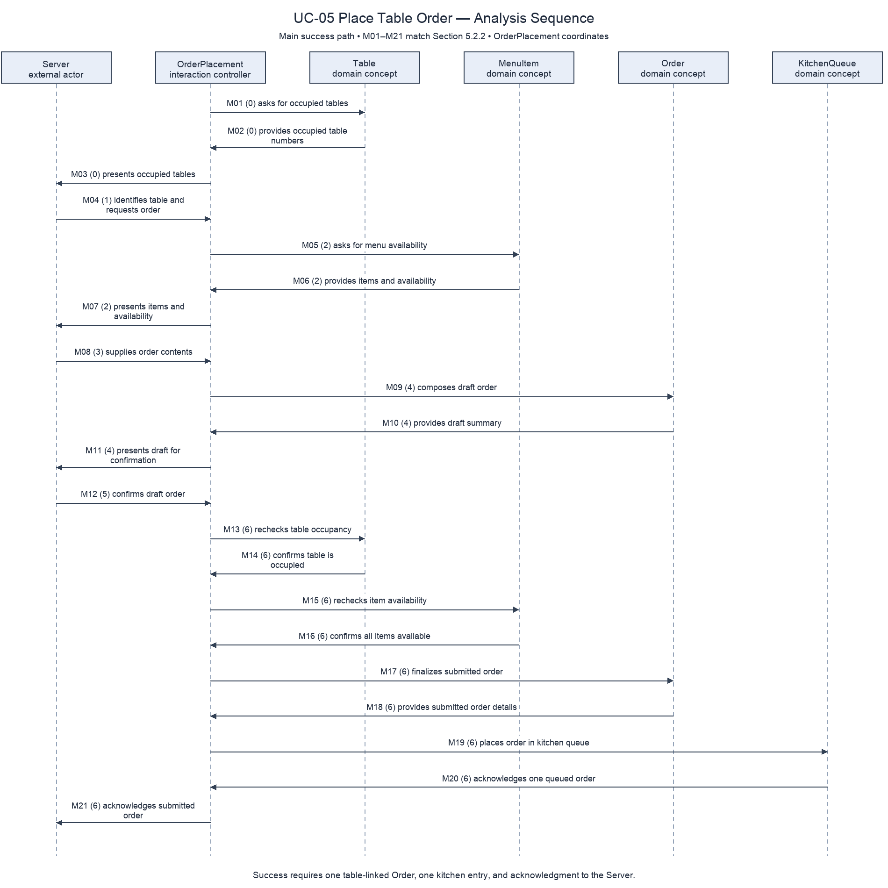

# Gabriel Suarez P2 Use Case and Object Interaction

Owner: Gabriel Suarez (GXS220049). Sections 4.2 UC-05 and 5.2.2, for integration into the shared report.

## 4.2 UC-05 Place Table Order

| Field | Content |
| --- | --- |
| Primary actor | Server |
| Supporting actors and external systems | None. Kitchen Staff begin preparing the resulting order in UC-07; preparation is outside this use case. |
| TUCBW | The Server needs to place an order for a dining party. |
| TUCEW | The Server receives an acknowledgment identifying the submitted Order, its Table, its contents, and its queued status; or receives an explicit cancellation or failure outcome. |
| Preconditions | The Server is authorized to place orders. Restaurant table and menu information exists. Table occupancy and item availability are checked during the interaction, rather than assumed. |
| Success postconditions | Exactly one submitted Order is associated with the chosen Table and appears once in the KitchenQueue with matching OrderLines, quantities, preparation notes, order number, and submission time. Its status is queued, and the Server has received acknowledgment. |
| Minimal guarantee | A rejected or canceled attempt creates no submitted Order or KitchenQueue entry. A draft can be corrected without changing an existing submitted Order. |
| Traces to requirements | FR-07 (table-linked order), FR-08 (unavailable-item rejection), FR-09 (kitchen submission); QR-01 constrains timely delivery of the submitted order to the kitchen. |

### Main success scenario

Each numbered row is one turn. Step (0) is the information available before the Server acts.

| Actor input / action | System response |
| --- | --- |
| — | **(0)** Identifies the occupied Tables by table number and indicates that an Order can be started. |
| **(1)** The Server identifies the Table for the dining party and requests a new Order. | — |
| — | **(2)** Identifies the MenuItems and their current availability for the selected Table's Order. |
| **(3)** The Server specifies the MenuItems, quantities, and any preparation notes for the Order. | — |
| — | **(4)** Presents the draft Order with its table number, MenuItems, quantities, and preparation notes, and asks the Server to confirm or revise it. |
| **(5)** The Server confirms the Order for the identified Table. | — |
| — | **(6)** Acknowledges that the Order has been submitted to the kitchen, giving its order number, table number, MenuItems, quantities, preparation notes, submission time, and queued status. |

### Alternate flows

| Alternate flow | At step | Condition | What happens | Ends or rejoins at |
| --- | --- | --- | --- | --- |
| A1 | (0) | No occupied Table exists. | The system states that no Table is ready for an Order. The Server ends the attempt or waits for seating to be completed through UC-04. | Ends without a submitted Order; a later attempt starts at (0). |
| A2 | (2) or (6) | The chosen Table is no longer occupied. | The system identifies the Table as unavailable for this Order and asks for another Table. The Server identifies an occupied Table or cancels. | Rejoins (2) after a new (1), or ends through A6. |
| A3 | (4) | An item is unavailable, no MenuItems were specified, or a quantity is not a positive whole number. | The system identifies the affected MenuItem or quantity and says the Order is not submitted. The Server replaces/removes the item or corrects the quantity. If no items are available, the Server cancels or returns later. | Rejoins (4) after a corrected (3), or ends through A6. |
| A4 | (5) | The Server finds an error in the summary. | Instead of confirming, the Server supplies revised MenuItems, quantities, or preparation notes. The system presents the corrected draft. | Rejoins (4), then (5). |
| A5 | (6) | A MenuItem became unavailable after the summary was presented. | The system identifies the item and explicitly reports that the Order has not been submitted. The Server revises the Order or cancels. | Rejoins (4) after a corrected (3), or ends through A6. |
| A6 | (1), (3), or (5) | The Server abandons the attempt before submission. | The Server asks to cancel. The system acknowledges cancellation and states that no Order was submitted. | Ends; success postconditions do not apply. |
| A7 | (6) | The Order cannot be accepted for kitchen preparation. | The system explicitly reports submission failure and states that no submitted Order or kitchen entry was created. The Server may try the retained draft again or cancel. | Rejoins (5) for a new confirmation, or ends through A6. |

A7 describes a known failed outcome. If the Server receives no acknowledgment and the outcome is unknown, the Server must establish whether the Order was accepted before trying again; recovery for an uncertain outcome needs agreement with the architect rather than an invented guarantee. Kitchen preparation and subsequent ready/served status changes belong to UC-07 and UC-06.

## 5.2.2 UC-05 Place Table Order

### (a) Non-trivial steps

| Section 4.2 step | Why internal collaboration is needed |
| --- | --- |
| (0) | Table occupancy determines which table numbers can be offered. |
| (2) | MenuItem availability must be obtained for the chosen Table. |
| (4) | Order composes OrderLines and supplies a complete, table-linked draft for review. |
| (6) | Table occupancy and MenuItem availability must be rechecked, the Order finalized, and kitchen acceptance established before acknowledgment. |

Steps (1), (3), and (5) are trivial actor inputs: they identify the Table, supply Order contents, and confirm the summary. They are still included as messages so the sequence preserves the actor's turns. Alternate flows are specified in 4.2; the scenario table and sequence below depict the main success path with successful rechecks, not a claim that failure branches were executed.

**Interaction objects:** OrderPlacement coordinates this use case; it is a conceptual interaction controller, not a domain entity or an implementation class. Server is the external actor. Table, MenuItem, Order, OrderLine, and KitchenQueue are proposed domain concepts to reconcile with Jarir's Section 5.1 before integration. OrderLine is composed within Order and does not require a separate lifeline in this interaction.

### (b) Scenario table

Each subject/action/receiver combination reads as a declarative sentence. Message IDs match the diagram exactly; the parenthesized number identifies the Section 4.2 turn.

| Step | Subject (who acts) | Subject action (what it does) | Other data / objects (what is used) | Object acted upon (who receives) |
| --- | --- | --- | --- | --- |
| M01 (0) | OrderPlacement | asks for occupied tables | table occupancy | Table |
| M02 (0) | Table | provides occupied table numbers | table numbers | OrderPlacement |
| M03 (0) | OrderPlacement | presents occupied tables | table numbers | Server |
| M04 (1) | Server | identifies table and requests order | table number | OrderPlacement |
| M05 (2) | OrderPlacement | asks for menu availability | selected Table | MenuItem |
| M06 (2) | MenuItem | provides items and availability | item names, availability | OrderPlacement |
| M07 (2) | OrderPlacement | presents items and availability | item names, availability | Server |
| M08 (3) | Server | supplies order contents | MenuItems, quantities, preparation notes | OrderPlacement |
| M09 (4) | OrderPlacement | composes draft order | Table, OrderLines with MenuItems, quantities, preparation notes | Order |
| M10 (4) | Order | provides draft summary | table number, item names, quantities, preparation notes | OrderPlacement |
| M11 (4) | OrderPlacement | presents draft for confirmation | complete draft summary | Server |
| M12 (5) | Server | confirms draft order | reviewed draft | OrderPlacement |
| M13 (6) | OrderPlacement | rechecks table occupancy | chosen Table | Table |
| M14 (6) | Table | confirms table is occupied | table number, occupancy | OrderPlacement |
| M15 (6) | OrderPlacement | rechecks item availability | all MenuItems in Order | MenuItem |
| M16 (6) | MenuItem | confirms all items available | current availability | OrderPlacement |
| M17 (6) | OrderPlacement | finalizes submitted order | reviewed draft, unique order number, submission time, queued status | Order |
| M18 (6) | Order | provides submitted order details | order number, Table, OrderLines, submission time, queued status | OrderPlacement |
| M19 (6) | OrderPlacement | places order in kitchen queue | submitted Order and matching details | KitchenQueue |
| M20 (6) | KitchenQueue | acknowledges one queued order | order number, queued status | OrderPlacement |
| M21 (6) | OrderPlacement | acknowledges submitted order | order number, table number, items, quantities, notes, submission time, queued status | Server |

Finalization and kitchen acceptance form one successful business outcome. If acceptance fails, A7 requires that neither a submitted Order nor a kitchen entry remains. The mechanism that preserves this invariant belongs in the architecture and ADRs, not in this analysis model.

### (c) Analysis sequence diagram

Figure 5.2.2. Main success path for UC-05. Message IDs M01–M21 correspond one-to-one with the scenario table. OrderPlacement is clearly the coordinator. Editable source: `docs/p2/diagrams/seq-uc05.drawio`.

### Domain vocabulary handoff to Section 5.1

| Proposed concept | Attributes needed by this use case | Associations needed |
| --- | --- | --- |
| Table | table number, occupancy | Each Order belongs to one Table; a Table can have zero or more Orders over time. |
| MenuItem | item name, availability | Each OrderLine refers to one MenuItem; a MenuItem can appear in zero or more OrderLines. |
| Order | order number, submission time, status | One Table; one or more OrderLines when submitted; zero or one active KitchenQueue membership. |
| OrderLine | quantity, preparation notes | One Order and one MenuItem. |
| KitchenQueue | queue membership/order sequence | Zero or more queued Orders; each active queued Order appears once. |

These names are a handoff proposal because no completed Section 5.1 is present on the fetched main branch. Jarir must confirm names and multiplicities; this file does not report K1/K2 as passed against an absent model.
